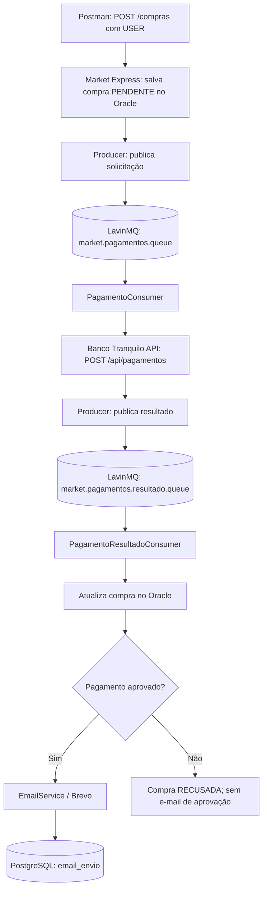
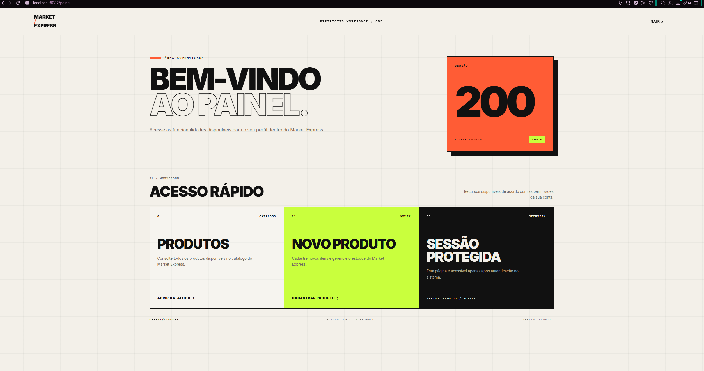

# MARKET EXPRESS

### FIAP · Java Advanced · Checkpoint 5 — Partes I e II

Aplicação web de gerenciamento de produtos e processamento assíncrono de compras, desenvolvida em **Java 17, Spring Boot, Spring Security, Thymeleaf e Maven**. O projeto reúne autenticação e autorização por perfis, catálogo e CRUD administrativo, API REST com HATEOAS e um fluxo de pagamentos integrado a **LavinMQ (CloudAMQP)**, uma API simulada do **Banco Tranquilo**, **Brevo** e dois bancos de dados.

> **Contexto acadêmico:** a API Banco Tranquilo implementada neste repositório simula decisões de pagamento; não movimenta dinheiro real.

## Links da aplicação

| Recurso | Endereço |
|---|---|
| Market Express — aplicação | [java-cp4-5vb8.onrender.com](https://java-cp4-5vb8.onrender.com/) |
| Login | [Abrir login](https://java-cp4-5vb8.onrender.com/login) |
| Catálogo | [Abrir catálogo](https://java-cp4-5vb8.onrender.com/itens) |
| Painel autenticado | [Abrir painel](https://java-cp4-5vb8.onrender.com/painel) |
| Dashboard gerencial (ADMIN) | [Abrir dashboard](https://java-cp4-5vb8.onrender.com/admin/dashboard) |
| Banco Tranquilo — API | [banco-tranquilo-api.onrender.com](https://banco-tranquilo-api.onrender.com) |
| Código-fonte | [gugomesx10/java-cp5-parte1](https://github.com/gugomesx10/java-cp5-parte1) |

**Observação:** `/api/pagamentos` é um endpoint `POST` do Banco Tranquilo. A abertura da raiz dessa API no navegador não é o teste de pagamento. Serviços gratuitos do Render podem demorar no primeiro acesso após um período de inatividade.

## Funcionalidades

### Parte I — Aplicação web e segurança

- Landing page pública e catálogo de produtos.
- Cadastro e autenticação local de usuários, com senhas protegidas por **BCrypt**.
- Login social via **GitHub OAuth2**.
- Painel autenticado e página personalizada de acesso negado.
- Controle de acesso com **Spring Security**, usando `USER` e `ADMIN`.
- CRUD administrativo de produtos, persistido no **Oracle Database**.
- API REST de produtos com **Spring HATEOAS**.
- Segurança HTTP: CSRF nos formulários MVC, CSP, Referrer Policy e Permissions Policy.
- Deploy da aplicação com Docker no Render.

### Parte II — Mensageria e integração de pagamentos

- Registro de compras pela API `POST /compras`.
- Persistência das compras no Oracle com status inicial `PENDENTE`.
- Publicação de solicitações e resultados de pagamento em filas do **LavinMQ/RabbitMQ**.
- Integração HTTP com a API independente **Banco Tranquilo**.
- Atualização assíncrona de compras para `APROVADA` ou `RECUSADA`.
- Envio de e-mail de confirmação de compra **somente quando o pagamento é aprovado**, por meio da API **Brevo**.
- Registro de tentativas e resultados do envio na tabela `email_envio`, em **PostgreSQL**.
- Dashboard gerencial com indicadores, gráfico de status e histórico de compras recentes.
- Deploy separado do Market Express e da API Banco Tranquilo no Render.

## Perfis e autorização

| Operação | Visitante | USER | ADMIN |
|---|:---:|:---:|:---:|
| Ver landing page e catálogo | ✅ | ✅ | ✅ |
| Fazer login e acessar painel | — | ✅ | ✅ |
| Cadastrar, editar e excluir produtos | — | — | ✅ |
| Criar compra via `POST /compras` | — | ✅ | — |
| Consultar todas as compras via `GET /compras` | — | — | ✅ |
| Acessar `/admin/dashboard` | — | — | ✅ |

Contas criadas no formulário ou via GitHub recebem o perfil `USER`; o acesso administrativo é configurado por variáveis de ambiente. A criação de compra está disponível **pela API**, autenticada com usuário `USER`. **Não há carrinho ou formulário de checkout implementado no frontend** nesta versão.

## Tecnologias e ferramentas

| Camada | Tecnologias |
|---|---|
| Backend | Java 17, Spring Boot 4.1.x, Spring MVC, Maven, Lombok |
| Segurança | Spring Security, BCrypt, GitHub OAuth2, HTTP Basic para testes de API |
| Interface | Thymeleaf, HTML e CSS |
| Persistência principal | Oracle Database, Spring Data JPA, Hibernate |
| Auditoria de e-mail | PostgreSQL, Spring JDBC (`JdbcTemplate`) |
| Mensageria | Spring AMQP, RabbitMQ/LavinMQ, CloudAMQP |
| Pagamentos | API Banco Tranquilo (microsserviço Spring Boot), Spring `RestClient` |
| Notificações | API transacional Brevo |
| Deploy e testes | Docker, Render, Postman, IntelliJ IDEA, Git/GitHub |

## Organização do repositório

```text
java-cp5-parte1/
├── Dockerfile                       # Market Express
├── pom.xml
├── src/main/java/br/com/fiap/market/
│   ├── config/                     # SecurityConfig, RabbitMQConfig e datasource de e-mails
│   ├── controller/                 # MVC, REST, compras e dashboard
│   ├── dto/                        # Requisições, respostas e mensagens
│   ├── entity/                     # Item, Usuario, Compra
│   ├── integration/                # BancoTranquiloClient e BrevoEmailClient
│   ├── messaging/                  # Producers e consumers das filas
│   ├── repository/                 # Oracle JPA e PostgreSQL JDBC
│   └── service/                    # Regras de negócio
├── src/main/resources/
│   ├── application.yml
│   ├── templates/                   # Thymeleaf, painel e dashboard
│   └── static/css/
└── banco-tranquilo-api/
    ├── Dockerfile
    ├── pom.xml
    └── src/                       # API independente de processamento de pagamentos
```

## Arquitetura e fluxo da compra



### Configuração da mensageria

Implementada em `RabbitMQConfig.java`:

| Elemento | Nome |
|---|---|
| Direct exchange | `market.pagamentos.exchange` |
| Fila de solicitações | `market.pagamentos.queue` |
| Routing key de solicitações | `market.pagamentos.processar` |
| Fila de resultados | `market.pagamentos.resultado.queue` |
| Routing key de resultados | `market.pagamentos.resultado` |

As duas filas são declaradas como duráveis. A conversão das mensagens é feita em JSON com `JacksonJsonMessageConverter`. O consumidor da primeira fila chama o Banco Tranquilo via HTTP, publica a resposta e o consumidor da segunda fila atualiza a compra.

### Regra acadêmica do Banco Tranquilo

A API está no módulo `banco-tranquilo-api`, com endpoint `POST /api/pagamentos`. O processamento é **simulado**:

- Valor até **R$ 1.000,00** (inclusive): `APROVADO`.
- Valor superior a **R$ 1.000,00**: `RECUSADO`.
- A resposta inclui `transacaoId` (UUID), `compraId`, `status`, `mensagem` e `processadoEm`.

Essa regra é determinística para facilitar a demonstração de cenários de aprovação e recusa.

## Endpoints principais

### Market Express

| Método | Endpoint | Acesso | Finalidade |
|---|---|---|---|
| GET | `/` | Público | Landing page |
| GET | `/login` | Público | Login personalizado |
| GET/POST | `/cadastro` | Público | Cadastro local de usuários |
| GET | `/itens` | Público | Catálogo de produtos |
| GET | `/painel` | Autenticado | Painel do usuário |
| GET | `/admin/dashboard` | ADMIN | Dashboard gerencial |
| POST | `/compras` | USER | Registrar compra e iniciar processamento assíncrono |
| GET | `/compras` | ADMIN | Listar compras |
| GET | `/mercado` e `/mercado/{id}` | Público | API REST de produtos/HATEOAS |
| POST/PUT/PATCH/DELETE | `/mercado` e `/mercado/{id}` | ADMIN | CRUD REST de produtos |

O CRUD de produtos também possui formulários MVC protegidos para `ADMIN` (`/itens/novo`, edição e exclusão).

### Banco Tranquilo API

| Método | Endpoint | Finalidade |
|---|---|---|
| POST | `/api/pagamentos` | Simular aprovação ou recusa de pagamento |

## Testes com Postman

### 1. Criar compra aprovada

**POST** `https://java-cp4-5vb8.onrender.com/compras`

Em **Authorization → Basic Auth**, informe um usuário **USER** cadastrado no Market Express. Em **Body → raw → JSON**:

```json
{
  "valorTotal": 149.90,
  "emailCliente": "cliente@example.com"
}
```

A API retorna **HTTP 201 Created**, com uma compra inicialmente `PENDENTE`. O `compraId` é atribuído pelo Oracle, e não precisa ser enviado pelo cliente. Após o processamento assíncrono, a compra passa para `APROVADA`; o sistema solicita o envio do e-mail à Brevo e registra o resultado no PostgreSQL.

> Para verificar **o recebimento real do e-mail**, use na demonstração um endereço de e-mail que você controle, sem expor seu endereço pessoal na gravação.

### 2. Criar compra recusada

**POST** `https://java-cp4-5vb8.onrender.com/compras`

```json
{
  "valorTotal": 1500.00,
  "emailCliente": "cliente@example.com"
}
```

O fluxo de mensageria é o mesmo, mas a API Banco Tranquilo retorna `RECUSADO`. O Market Express atualiza a compra para `RECUSADA` e **não envia confirmação de pagamento aprovado**.

### 3. Consultar resultado

**GET** `https://java-cp4-5vb8.onrender.com/compras`

Use **Basic Auth com ADMIN** para listar as compras e seus status. Também é possível fazer login com ADMIN no site e abrir o [dashboard gerencial](https://java-cp4-5vb8.onrender.com/admin/dashboard).

### 4. Testar isoladamente o Banco Tranquilo

**POST** `https://banco-tranquilo-api.onrender.com/api/pagamentos`

```json
{
  "compraId": 999,
  "valor": 149.90
}
```

`999` é apenas um identificador de **teste independente**: não representa uma compra criada no Oracle. Quando a requisição parte do Market Express, o ID correto é gerado pelo sistema e encaminhado automaticamente.

## Persistência e auditoria

**Oracle Database** — persistência operacional de usuários, produtos e compras:

- `TDS_TB_MERCADO`: catálogo de produtos.
- `TDS_TB_USUARIO`: usuários locais e vinculados ao GitHub.
- `TDS_TB_COMPRA`: compras, valores, e-mails informados, status e datas.

**PostgreSQL** — controle de envio de e-mails via tabela `email_envio`:

- `compra_id` (único), `destinatario`, `assunto`.
- `status`: `PENDENTE`, `ENVIADO` ou `FALHA`.
- `tentativas`, `criado_em`, `enviado_em`, `erro`.

O status `ENVIADO` indica **aceitação da solicitação pela API da Brevo**, não garantia de entrega na caixa de entrada. O índice único por `compra_id` impede registrar duas linhas para a mesma compra. A implementação atual **não dispõe de rotina automática de reenvio para falhas**.

Consulta de demonstração no PostgreSQL:

```sql
SELECT compra_id, status, tentativas, criado_em, enviado_em
FROM email_envio
ORDER BY criado_em DESC;
```

## Dashboard gerencial

Disponível em **`/admin/dashboard`**, exclusivamente para `ADMIN`.

O dashboard consulta dados reais do Oracle e apresenta:

- Total de compras e valor acumulado de compras **aprovadas**.
- Quantidade de compras aprovadas, recusadas e pendentes.
- Número de **produtos cadastrados** no catálogo.
- Gráfico de distribuição de compras por status.
- Histórico das **10 compras mais recentes**, com cliente, valor, situação e data.

**Limitação declarada:** não existe controle de quantidade física em estoque nem custo dos produtos no modelo atual. Por isso o dashboard **não calcula lucro nem saldo de estoque**; não são apresentados indicadores estimados como se fossem dados reais.

## Configuração de ambiente

Os arquivos de configuração utilizam variáveis de ambiente. **Nunca versionar ou publicar valores de credenciais.**

| Variável | Uso |
|---|---|
| `SPRING_DATASOURCE_URL` | JDBC Oracle |
| `SPRING_DATASOURCE_USERNAME` | Usuário do Oracle |
| `SPRING_DATASOURCE_PASSWORD` | Senha do Oracle |
| `GITHUB_CLIENT_ID` | OAuth2 GitHub |
| `GITHUB_CLIENT_SECRET` | OAuth2 GitHub |
| `ADMIN_USERNAME` | Login administrativo |
| `ADMIN_PASSWORD` | Senha administrativa |
| `CLOUDAMQP_URL` | URL AMQPS do LavinMQ/CloudAMQP |
| `BANCO_TRANQUILO_URL` | Base URL da API Banco Tranquilo |
| `BREVO_API_KEY` | Token da API Brevo |
| `BREVO_SENDER_EMAIL` | Remetente verificado na Brevo |
| `EMAIL_DB_URL` | JDBC PostgreSQL da auditoria |
| `EMAIL_DB_USERNAME` | Usuário PostgreSQL |
| `EMAIL_DB_PASSWORD` | Senha PostgreSQL |

Exemplo **sem credenciais** de PostgreSQL:

```text
EMAIL_DB_URL=jdbc:postgresql://HOST:5432/NOME_DO_BANCO
```

O Market Express usa `application.yml` para consumir essas variáveis. O serviço do Banco Tranquilo é um segundo aplicativo Spring Boot independente.

### Execução local

Requisitos: **JDK 17, Maven, Oracle acessível, PostgreSQL acessível, CloudAMQP/LavinMQ e credenciais das integrações**.

Em um terminal, inicie o Banco Tranquilo:

```bash
cd banco-tranquilo-api
mvn spring-boot:run
```

Em outro terminal, na raiz do repositório, execute o Market Express com todas as variáveis configuradas:

```bash
mvn spring-boot:run
```

Portas locais padrão: Market Express `8082`; Banco Tranquilo `8083`. Em desenvolvimento, `BANCO_TRANQUILO_URL` pode apontar para `http://localhost:8083`. Em produção, utilize `https://banco-tranquilo-api.onrender.com`.

### Deploy

Os dois aplicativos usam **Docker** e estão publicados como **Web Services separados no Render**, a partir do mesmo repositório:

```text
GitHub / main
   ├── Market Express (Dockerfile da raiz)
   └── Banco Tranquilo (banco-tranquilo-api/Dockerfile)

Market Express → Oracle + LavinMQ + Brevo + PostgreSQL
Market Express → Banco Tranquilo (HTTPS)
```

O serviço Market Express aponta para a API de pagamentos através de `BANCO_TRANQUILO_URL`. As credenciais são configuradas exclusivamente nas variáveis de ambiente dos serviços.

## Evidências e capturas de tela

### Parte I — Interface e autenticação

| Evidência | Imagem |
|---|---|
| Painel |  |
| Catálogo |  |
| Login |  |
| Cadastro de usuário |  |
| Área administrativa |  |
| Cadastro de produto |  |
| Edição de produto |  |
| Acesso negado |  |
| API REST |  |
| Oracle |  |

### Parte II — Evidências recomendadas para anexar

Acrescentar capturas de tela **reais**, após salvá-las no repositório (por exemplo, em `src/main/img/cp5-parte2/`):

1. Dashboard gerencial mostrando indicadores, gráfico e tabela.
2. Postman: resposta da compra criada (`201`) e consulta posterior mostrando `APROVADA`.
3. Postman: compra `RECUSADA` com valor superior a R$ 1.000,00.
4. Painel LavinMQ: exchange, filas de solicitação/resultado e atividade de mensagens.
5. PostgreSQL: tabela `email_envio`, sem expor dados sensíveis.
6. E-mail de confirmação recebido, ocultando dados pessoais.
7. Render: dois serviços publicados, sem mostrar variáveis secretas.

## Testes e critérios demonstrados

- CRUD de produtos e bloqueio das operações administrativas para `USER`.
- Login local e login GitHub OAuth2; painel restrito.
- API REST de produtos e HATEOAS.
- Compra aprovada e compra recusada, via Postman.
- Mensagens de solicitação e de resultado no LavinMQ.
- Integração HTTP com a API Banco Tranquilo.
- Persistência dos resultados no Oracle.
- E-mail de confirmação de compra aprovada e registro de auditoria em PostgreSQL.
- Indicadores, gráfico de pagamentos e histórico no dashboard gerencial.
- Deploy dos dois serviços no Render.

O vídeo da apresentação mostra o código, a aplicação e as integrações em execução.

## Integrantes

| Nome | RM |
|---|---|
| Gustavo Gomes Martins | 555999 |
| Matheus de Mattos Vecchi | 561716 |
| Nicholas Albuquerque Buzo | 561082 |
| Nicholas Camillo Canadas de Paula | 561262 |

**Instituição:** FIAP  
**Curso:** Tecnologia em Análise e Desenvolvimento de Sistemas  
**Disciplina:** Java Advanced  
**Avaliação:** Checkpoint 5 — Partes I e II  
**Professor:** Dr. Marcel Stefan Wagner  
**IDE:** IntelliJ IDEA

---

**Market Express** — autenticação, catálogo, mensagens, pagamentos e auditoria integrados em uma aplicação acadêmica Java/Spring Boot.
